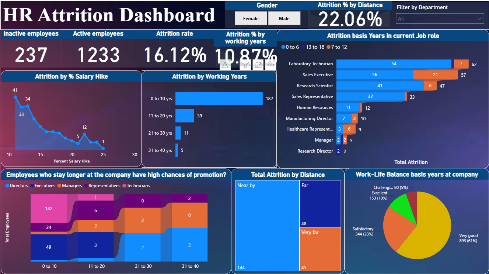
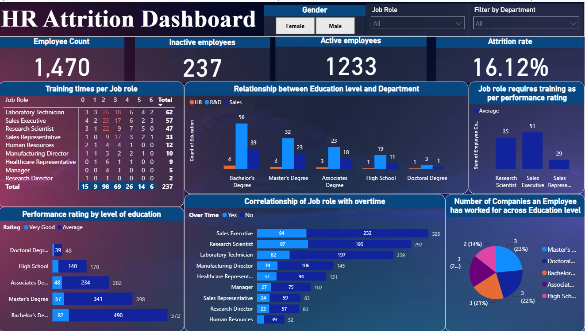

# HR Attrition Analysis: Power BI Dashboard

**Power BI | HR Analytics | Employee Attrition | Data Visualization**

Prepared by **Shubham Shah**

---





> Both pages have slicers (Gender, Department, Job Role) that filter every visual on the page.

---

## 1. Project Overview

Employee attrition is costly: recruiting, onboarding and training replacements takes time and money, and every departure takes experience out of the team. This project analyses a 1,470-employee HR dataset in **Power BI** to show who is leaving, which factors go with leaving, and where HR should act first.

The report answers questions such as:
- What is the overall attrition rate, and how many employees are active vs inactive?
- Which departments, job roles, age groups and tenure bands lose the most people?
- How do overtime, business travel, salary hike, distance from home and satisfaction relate to attrition?
- How do performance ratings, education and training vary across roles?

### Stakeholders
HR leadership and business partners, department heads and line managers, Finance (cost of turnover), senior leadership, and employees.

---

## 2. Dataset

| Item | Detail |
|---|---|
| File | `Hr_data.csv` |
| Records | 1,470 employees |
| Columns | 39 (no missing values) |
| Target | `Attrition` (Yes = left / ex-employee, No = current employee) |
| Attrition | 237 inactive employees, 1,233 active, rate 16.12% |

**Main field groups**
- **Demographics:** Age, Gender, Marital Status, Education, Education Field
- **Job:** Department, Job Role, Job Level, Business Travel, Over Time, Distance From Home
- **Pay:** Monthly Income, Percent Salary Hike, Stock Option Level (plus daily / hourly / monthly rate fields)
- **Experience:** Total Working Years, Years At Company, Years In Current Role, Years Since Last Promotion, Years With Curr Manager, Num Companies Worked
- **Survey and performance:** Job / Environment / Relationship Satisfaction, Job Involvement, Work Life Balance, Performance Rating, Training Times Last Year
- **Calculated fields:** `CF_age band`, `CF_attrition label`, `CF_current Employee`

`Employee Count`, `Standard Hours` and `Over18` are constant, so they carry no analytical value. A sample problem statement with the full data dictionary is in `Problem_Statement_HR_Attrition.docx`.

---

## 3. Requirements

**Functional**
- Show headline KPIs: employee count, active, inactive and attrition rate.
- Break attrition down by department, job role, age, tenure, pay, overtime, travel, distance and satisfaction.
- Provide interactive filters (Gender, Department, Job Role).
- Present performance, education and training views.

**Technical**
- Power BI Desktop to open `Hr_Analytics_Power_BI.pbix` (the file is small, under 1 MB).
- `Hr_data.csv` as the source data.

---

## 4. Tools and Technologies

| Area | Used |
|---|---|
| BI tool | Microsoft Power BI Desktop |
| Data preparation | Power Query (import and shaping), calculated columns for age, working-years, distance, income, years-at-company and satisfaction groupings |
| Calculations | DAX measures such as Total Employees, Total Attrition and Attrition % |
| Visuals | Cards, KPI visuals, slicers, bar and column charts, area and line charts, funnel, ribbon, treemap, donut and pie charts, tables / matrices |

---

## 5. Report Pages

The report has five pages. The two screenshots above show **Attrition Analysis II** (`Attrition_Analysis.png`) and **Performance Analysis** (`Performance_Analysis.png`).

| Page | Focus |
|---|---|
| Attrition Analysis | Attrition by department, job role, business travel, overtime, education field, age group, monthly income, years at company and work-life balance of leavers |
| Attrition Analysis II | Attrition by salary hike, working years, years in current role, distance from home, promotion vs tenure and work-life balance by years at company |
| Performance Analysis | Training times, education vs department, performance rating, job role vs overtime |
| Job Satisfaction Analysis | Attrition by marital status, job satisfaction, environment satisfaction and job involvement |
| My Analysis | Text-only page (notes) |

---

## 6. Approach

1. **Load and inspect** the CSV (39 columns, 1,470 rows, no nulls) and note the constant columns.
2. **Prepare the data:** create groupings for continuous fields (working years, distance, age, income, years at company) so they read well in charts, and label coded fields such as performance rating and work-life balance.
3. **Define measures:** Total Employees, Total Attrition (inactive), Active Employees and Attrition %.
4. **Build the pages:** headline KPI cards first, then attrition breakdowns, then performance and satisfaction views.
5. **Add slicers** for Gender, Department and Job Role so each page can be explored by group.
6. **Review and format** with a consistent dark theme and clear visual titles.

---

## 7. Challenges Faced and How They Were Handled

| Challenge | Handling |
|---|---|
| **Imbalanced outcome:** only about 16% of employees left, so counts alone can mislead. | Showed both counts and attrition % (a small role can have a high rate with few people). |
| **Continuous fields** (income, distance, years) are hard to read as raw numbers. | Grouped them into bands and charted attrition per band. |
| **Coded values** (ratings, satisfaction scores) are not self-explanatory. | Used readable labels such as Very Good / Average and satisfaction levels. |
| **Constant or duplicate columns** (Employee Count, Standard Hours, Over18). | Kept out of the analysis; Employee Count is used only for counting. |
| **Some visuals show all employees and others only leavers**, which can confuse readers. | Gave each visual a clear title that says which population it shows. |
| **Several slicers on dense pages.** | Kept filters compact in the top bar and aligned all visuals to one grid. |
| **Small groups** (for example some job roles) give unstable percentages. | Read rates together with headcount and avoided strong claims about tiny groups. |

---

## 8. Key Insights

Overall attrition is **16.12%** (237 of 1,470 employees). The figures below were calculated from `Hr_data.csv`.

- **Overtime is the strongest single flag:** 30.5% of employees who work overtime left, versus 10.4% of those who do not.
- **Job role matters:** Sales Representatives have the highest attrition (39.8%), followed by Laboratory Technicians (23.9%) and HR (23.1%). Research Directors (2.5%), Managers (4.9%) and Healthcare Representatives / Manufacturing Directors (6.9%) are the lowest.
- **Department:** Sales 20.6%, HR 19.0%, R&D 13.8%.
- **Early career leaves most:** employees under 25 leave at 39.2%, and 182 of the 237 leavers (77%) have 10 or fewer total working years.
- **Pay:** employees earning up to 3,000 a month leave at 28.6%, versus 8.9% for those above 10,000. Leavers earn about 4,787 on average vs 6,833 for stayers.
- **Business travel:** frequent travellers leave at 24.9%, rare travellers at 15.0% and non-travellers at 8.0%.
- **Marital status:** single employees leave at 25.5%, married 12.5%, divorced 10.1%.
- **Distance from home:** attrition is about 14% within 10 units of home but about 21% beyond that.
- **Satisfaction:** employees with job satisfaction 1 leave at 22.8% versus 11.3% at level 4; environment satisfaction 1 gives 25.4% and work-life balance 1 gives 31.2% (small group of 80).
- **Seniority and equity:** job level 1 has 26.3% attrition, and employees with no stock options 24.4% versus about 8-9% for options level 1-2.
- **Performance ratings are narrow:** 1,244 employees (85%) are rated Average (3) and 226 Very Good (4), so ratings alone separate employees poorly.
- **Gender gap is small:** men 17.0%, women 14.8%.

> These are associations in one dataset, not proof of cause. Several factors overlap (for example junior employees have lower pay and shorter tenure), so treat each as a signal to investigate.

---

## 9. Recommendations

1. **Manage overtime:** review workloads and staffing in roles with heavy overtime (Sales Executive, Research Scientist, Laboratory Technician) and track overtime as an early-warning KPI.
2. **Focus on the first years:** run onboarding, mentoring and 6/12/24-month check-ins for employees under 25 and with under 10 years of experience.
3. **Review pay for the lowest bands and high-attrition roles:** benchmark Sales Representative and Laboratory Technician pay and consider structured raises or retention bonuses.
4. **Improve career paths:** make promotion timing and job-level progression clear, especially for job level 1.
5. **Review travel and commute policy:** consider travel limits, rotation, remote or hybrid options, and transport support for employees living far away.
6. **Use engagement surveys:** act quickly on low job satisfaction, environment and work-life-balance scores, with manager follow-up.
7. **Extend equity-style incentives:** consider wider stock-option or long-term incentive coverage for entry-level staff.
8. **Improve the data:** add exit-interview reasons, hire / exit dates, manager ID and compensation history to enable trend and cause analysis.
9. **Next step: build a risk model** (for example logistic regression) to rank employees by attrition risk, validate it with HR, and monitor it monthly.
10. **Handle data ethically:** keep employee data confidential, avoid using gender or marital status to decide anything about individuals, and run pilots before rolling out policy changes.

---

## 10. How to Use

1. Download `Hr_Analytics_Power_BI.pbix` and open it in Power BI Desktop. If asked, point the data source to `Hr_data.csv`.
2. Use the Gender, Department and Job Role slicers to filter each page.
3. Read the problem statement in `Problem_Statement_HR_Attrition.docx` for the full list of questions.

---

## 11. Limitations

- One snapshot of employees; there are no dates, so trends over time cannot be shown.
- No exit reasons or cost data, so the report shows who leaves, not why in the employee's own words.
- Some small groups have unstable percentages.
- Findings are associations and should be validated before policy changes.

---

## 12. Repository Structure

```
HR-Attrition-Analysis_Power_BI
|-- Attrition_Analysis.png
|-- Dashboard_Background.jpg
|-- Hr_Analytics_Power_BI.pbix
|-- Hr_data.csv
|-- Performance_Analysis.png
|-- Problem_Statement_HR_Attrition.docx
`-- README.md
```

| File | Description |
|---|---|
| `Attrition_Analysis.png` | Dashboard screenshot: Attrition Analysis II page |
| `Dashboard_Background.jpg` | Background image used for the Power BI dashboard pages |
| `Hr_Analytics_Power_BI.pbix` | Power BI report (five pages) |
| `Hr_data.csv` | HR dataset (1,470 employees, 39 columns) |
| `Performance_Analysis.png` | Dashboard screenshot: Performance Analysis page |
| `Problem_Statement_HR_Attrition.docx` | Case study and problem statement |
| `README.md` | Project documentation (this file) |

---

## Author

**Shubham Shah**
Power BI | Data Analytics | HR Analytics Portfolio Project
